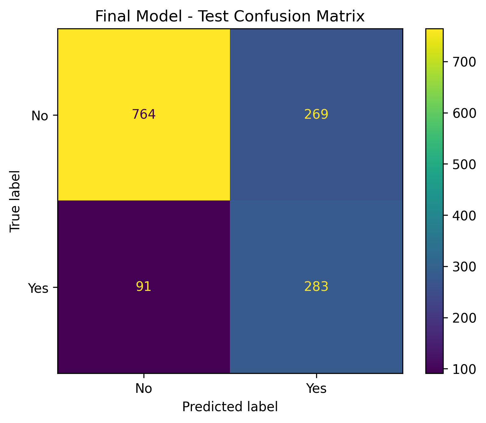

# 📉 Customer Churn Prediction

An end-to-end machine learning project that predicts whether a telecom customer is likely to leave, so a business can act *before* the customer is gone.

[](https://customer-churn-prediction-gy2aujks7kbpzgpuwjvjgo.streamlit.app/)


**👉 [Try the live app](https://customer-churn-prediction-gy2aujks7kbpzgpuwjvjgo.streamlit.app/)**

---

## 📌 Table of Contents

- [Problem Statement](#-problem-statement)
- [Dataset](#-dataset)
- [Approach](#-approach)
- [Results](#-results)
- [Key Takeaways](#-key-takeaways)
- [Project Structure](#-project-structure)
- [Getting Started](#-getting-started)
- [Author](#-author)

---

## 🎯 Problem Statement

Acquiring a new customer usually costs more than keeping an existing one. If a telecom company can identify customers who are likely to churn, it can offer targeted retention deals, better plans or support outreach before they leave.

This project builds a classification model that takes a customer's demographics, account details and subscribed services, and outputs the **probability that the customer will churn**.

## 📊 Dataset

| Item | Details |
|------|---------|
| Name | IBM Telco Customer Churn |
| Source | IBM sample data |
| Target | `Churn` (Yes / No) |
| Features | Demographics, account information (tenure, contract, billing), subscribed services |

The file lives at `data/Telco-Customer-Churn.csv`.

## 🛠️ Approach

1. **Data loading and cleaning**: fixing data types and handling missing or invalid values.
2. **Exploratory data analysis**: understanding churn patterns across contract type, tenure, charges and services.
3. **Feature engineering and preprocessing**: encoding categorical variables and scaling numeric features.
4. **Train / validation / test split**: a separate test set is kept untouched for the final evaluation.
5. **Model training**: three classifiers were compared:
   - Logistic Regression
   - Decision Tree
   - Random Forest
6. **Hyperparameter tuning**: `GridSearchCV` with 5-fold cross-validation, optimizing **F1-score**.
7. **Threshold optimization**: the decision threshold was tuned (to **0.55**) instead of using the default 0.5.
8. **Final evaluation** on the held-out test set, then saving the model with `joblib`.

## 🏆 Results

**Final model: Tuned Logistic Regression** (threshold = 0.55), evaluated on the held-out test set.

| Metric | Score |
|--------|------:|
| Accuracy | 74.41% |
| Precision | 51.27% |
| **Recall** | **75.67%** |
| F1-Score | 61.12% |
| ROC-AUC | 83.44% |

### Confusion Matrix



## 💡 Key Takeaways

- **Recall was prioritized.** Missing a customer who is about to leave (a false negative) is usually more costly than offering a retention deal to someone who would have stayed. The model catches about **76% of actual churners** (283 customers in the test set).
- **ROC-AUC of 83.4%** shows the model ranks churners above non-churners well, regardless of the chosen threshold.
- **Accuracy alone is misleading** here because the classes are imbalanced (most customers do not churn), so precision, recall, F1 and ROC-AUC were used to judge the model.
- **Precision is about 51%**: roughly half of the customers flagged as "likely to churn" would not actually leave. This is the trade-off of favoring recall, so the right threshold depends on the cost of a retention offer versus the value of a retained customer.
- A simple, interpretable model (Logistic Regression) outperformed the tree-based models on the validation set while staying easy to explain.

## 📁 Project Structure

```
customer-churn-prediction/
│
├── data/
│   └── Telco-Customer-Churn.csv
│
├── images/
│   └── confusion_matrix.png
│
├── models/
│   └── churn_model.pkl
│
├── notebooks/
│   └── churn_analysis.ipynb      # EDA and experimentation
│
├── src/
│   ├── __init__.py
│   ├── preprocessing.py          # cleaning and feature preparation
│   ├── split_data.py             # train / validation / test split
│   ├── train.py                  # model training and tuning
│   ├── evaluate.py               # metrics and threshold evaluation
│   └── predict.py                # load model and predict
│
├── app.py                        # Streamlit web app
├── main.py                       # command-line prediction example
├── requirements.txt
├── .gitignore
└── README.md
```

## 🚀 Getting Started

**1. Clone the repository**

```bash
git clone https://github.com/abhaygupta56/customer-churn-prediction.git
cd customer-churn-prediction
```

**2. (Recommended) Create a virtual environment**

```bash
python -m venv venv
source venv/bin/activate        # On Windows: venv\Scripts\activate
```

**3. Install dependencies**

```bash
pip install -r requirements.txt
```

**4. Run a sample prediction from the command line**

```bash
python main.py
```

Example output:

```
Churn Prediction Model Loaded Successfully

Prediction: Yes
Churn Probability: 88.42%
Threshold: 0.55
```

**5. Launch the Streamlit app locally**

```bash
streamlit run app.py
```

## 👤 Author

**Abhay Gupta**
Machine Learning | Artificial Intelligence | Python

- GitHub: [@abhaygupta56](https://github.com/abhaygupta56)

---

⭐ If you found this project useful, consider giving it a star!
